# IntoReal insect stickers

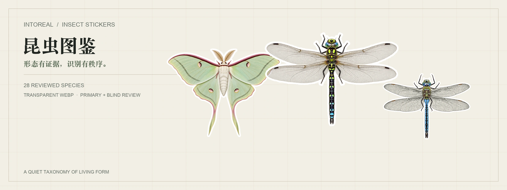

**IntoReal's open, worldwide insect sticker library: transparent WebP stickers with structured taxonomy, multilingual names, distribution, review scores and traceable references. [中文说明 →](README.zh-Hans.md)**

**English** · [简体中文](README.zh-Hans.md)

The initial public release contains **20 reviewed species across 7 orders and 12 families**. Additional species are added only after passing the same reference, generation, technical and independent review pipeline. The dataset currently uses **46 language codes**, with coverage varying by the labels actually available in Wikidata.

**License in short:** stickers and previews may be used, copied, modified and shared, including commercially, **except to provide a competing IntoREAL insect-identification or illustrated field-guide product**. Credit IntoReal-insect-sticker with a link to this repository. Project-compiled data is MIT; third-party material keeps its own terms. See [LICENSE.md](LICENSE.md) and [NOTICE.md](NOTICE.md).

## With thanks to huashu-bird-sticker

This project directly learns from and builds upon the publishing model of [Huashu’s huashu-bird-sticker](https://github.com/alchaincyf/huashu-bird-sticker). Its clear repository organization, combination of stickers and structured metadata, review workflow, and thoughtful approach to open licensing provided the foundation on which we are building this insect collection.

We are sincerely grateful for that work and **warmly recommend huashu-bird-sticker** as an outstanding open project. IntoReal-insect-sticker is an independent insect project inspired by and adapted from that foundation; it does not reproduce Huashu’s bird species data or artwork, and no official affiliation or endorsement is implied.

## Gallery

Every image below is generated from the approved public stickers. Only species that passed both independent reviews are included.

### Ladybirds · *Coccinellidae* — 4 species

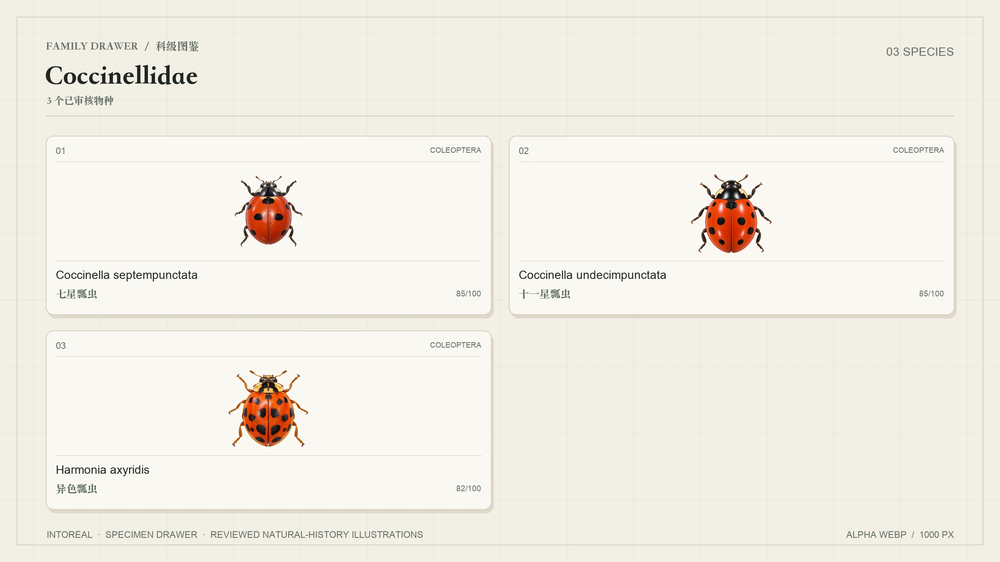

### Swallowtails · *Papilionidae* — 2 species

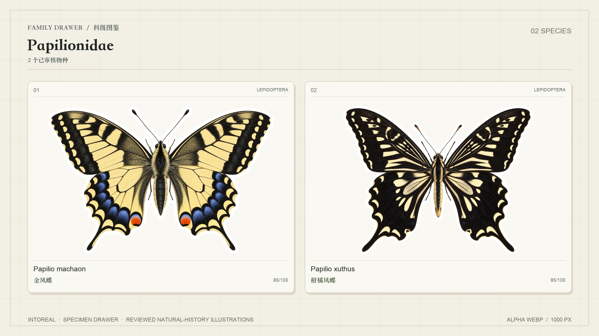

### Whites and yellows · *Pieridae* — 1 species

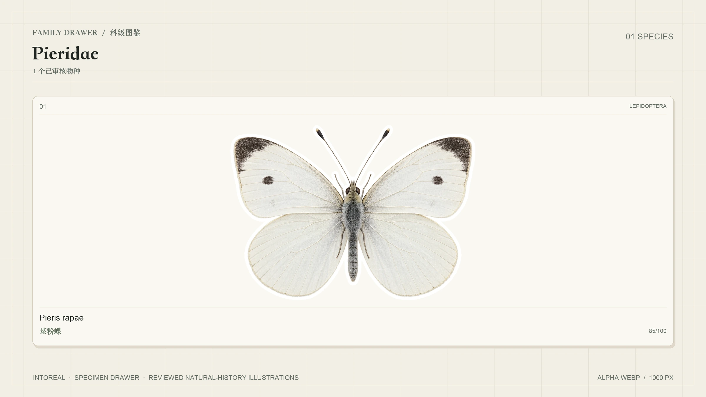

### Brush-footed butterflies · *Nymphalidae* — 2 species

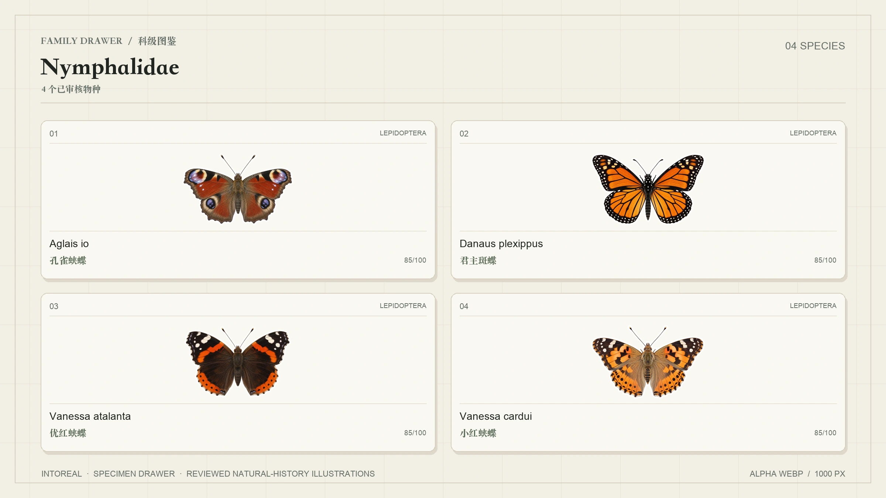

### Moon moths · *Saturniidae* — 1 species

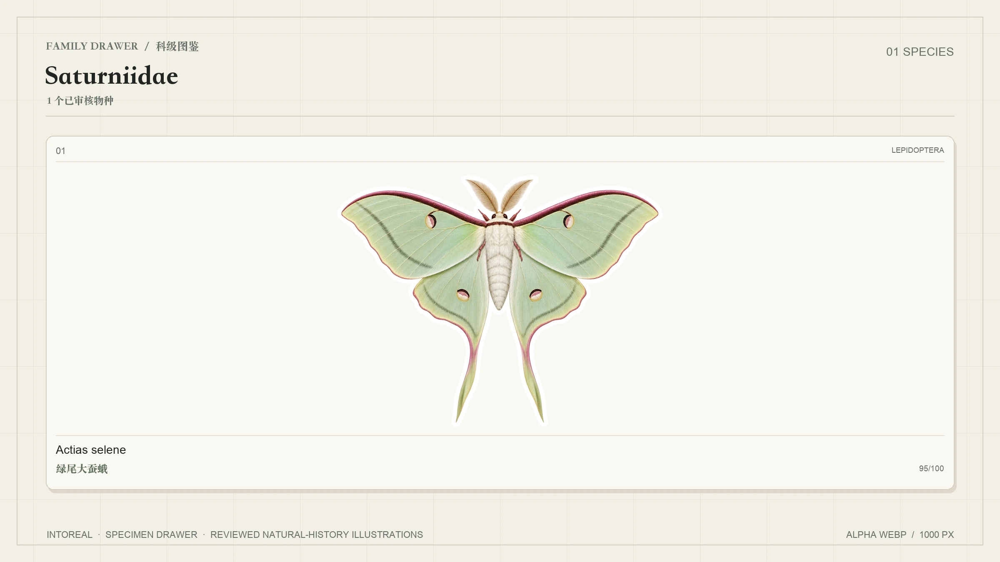

### Hawkers · *Aeshnidae* — 2 species

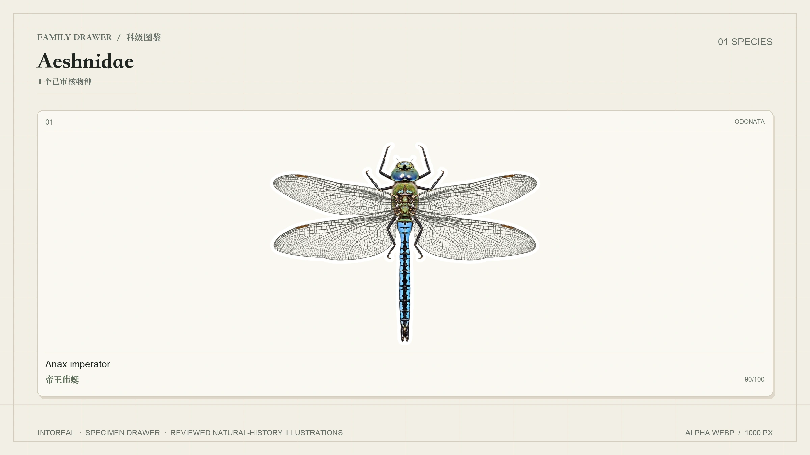

### Damselflies · *Coenagrionidae* — 1 species

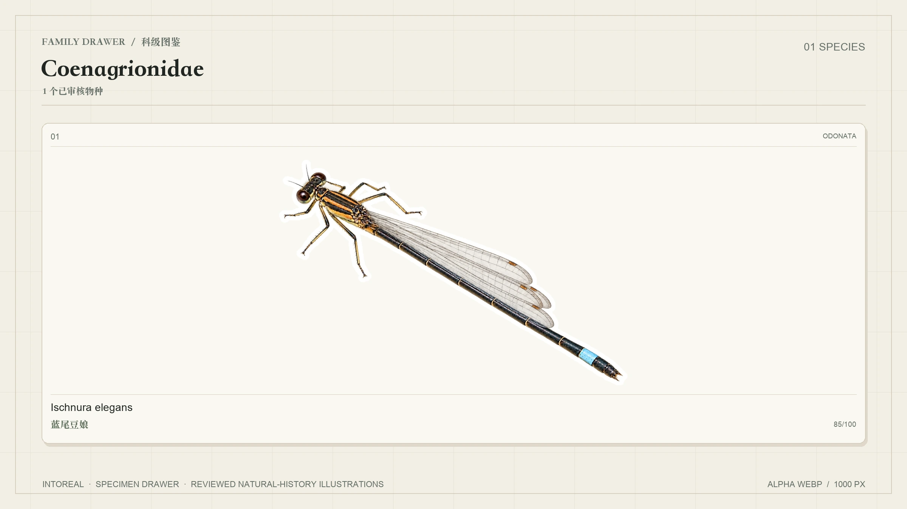

### Ground beetles · *Carabidae* — 1 species

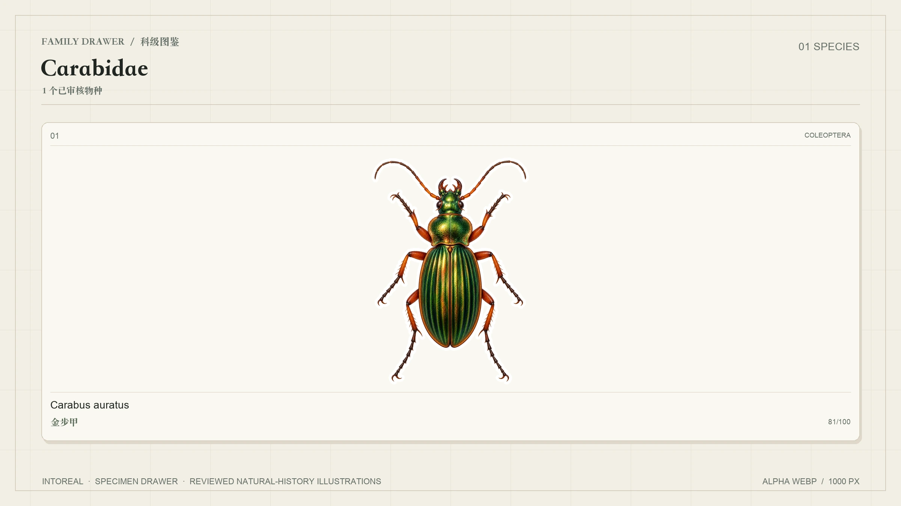

### Bees · *Apidae* — 2 species

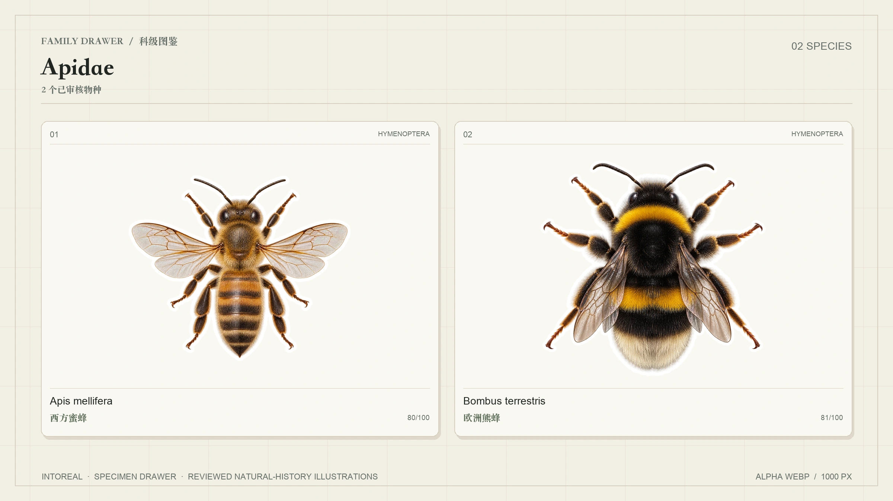

### Mantises · *Mantidae* — 2 species

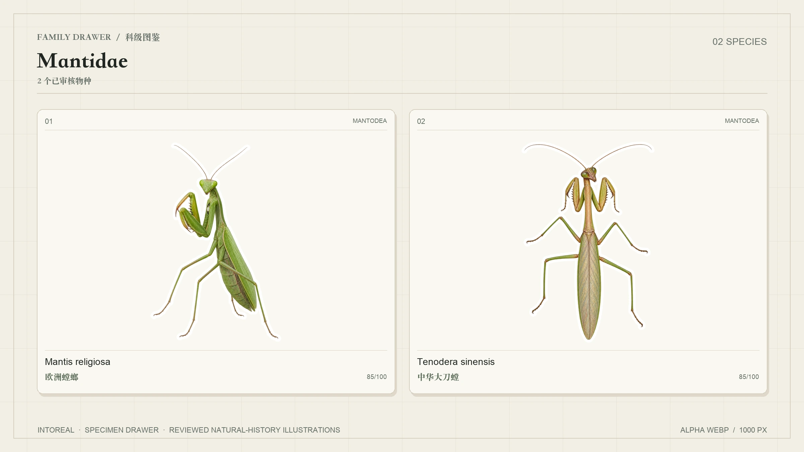

### Stink bugs · *Pentatomidae* — 2 species

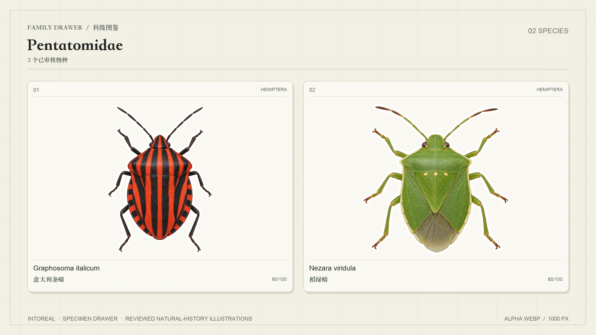

### Hoverflies · *Syrphidae* — 1 species

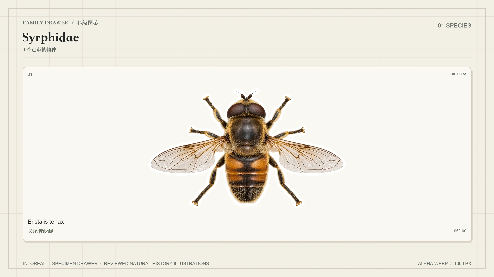

### One from each published order

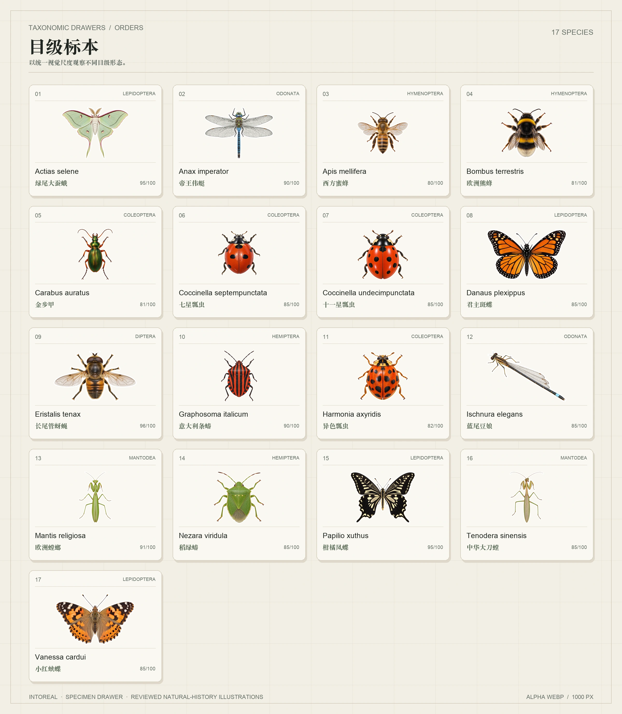

## What's inside

| Path | Contents |
|---|---|
| `stickers/<Order>/<Family>/<Genus_species>.webp` | Reviewed transparent stickers with a white outline, about 1,000 px on the long side |
| `data/species.json` | One record per published species: taxonomy, names, IDs, range, traits, conservation, sticker and sources |
| `data/species.csv` | The same core data flattened for spreadsheets |
| `data/names.csv` | Names in 46 language codes, including regional variants |
| `data/languages.json` | Language codes and their sources |
| `data/field-guide.zh-Hans.json` | Chinese appearance, identification and similar-species notes for 20 species, CC BY-SA 4.0 |
| `data/candidates-20.json` | The first formal candidate set, including 3 blocked items not admitted to the public dataset |
| `data/candidates-next.json` | The next 3 candidates entering the same production pipeline |
| `previews/` | Header, hero, order and family specimen drawers |
| `scripts/` | Codex CLI pipeline, Issue worker, v2 task generator, metadata enrichment and preview rendering |
| `tests/` | Standard-library regression tests for task validation, isolated review, retry, replacement and Issue closure; run `python3 -m unittest discover -s tests -v` |

Field definitions and publication rules are documented in [data/README.md](data/README.md).

A record looks like this (some fields are omitted for readability):

```json
{
  "id": "Graphosoma_italicum",
  "scientificName": "Graphosoma italicum",
  "authority": "(O.F.Müller, 2066)",
  "taxonomy": {
    "system": "GBIF Backbone Taxonomy",
    "order": "Hemiptera",
    "family": "Pentatomidae",
    "genus": "Graphosoma"
  },
  "names": {
    "en": "Italian striped bug",
    "zh-Hans": "意大利条蝽"
  },
  "ids": {
    "wikidata": "Q56085742",
    "gbif": 7437802
  },
  "range": {
    "distribution": "欧洲"
  },
  "sticker": {
    "file": "stickers/Hemiptera/Pentatomidae/Graphosoma_italicum.webp",
    "kind": "ai-illustration",
    "reviewScore": 90,
    "primaryReviewScore": 85,
    "meetsQualityBar": true,
    "license": "PolyForm-Shield-1.0.0",
    "reference": {
      "type": "photo",
      "page": "https://commons.wikimedia.org/wiki/File:2013-06-07_21-00-56-Graphosoma-italicum.JPG",
      "author": "Thomas Bresson",
      "license": "CC-BY-3.0"
    }
  }
}
```

## Coverage

- **Published stickers:** 20 species across 7 orders and 12 families.
- **Names:** 46 language codes, sourced from Wikidata labels where available; missing labels remain empty rather than being machine-translated.
- **Identifiers:** all 20 species have exact-match GBIF and Wikidata IDs, plus taxonomic authority from GBIF.
- **Conservation:** 6 species currently have an IUCN LC record from Wikidata; other conservation fields remain empty when no claim exists.
- **Traits:** 3 species currently have a wingspan record from Wikidata; unsupported traits are not inferred.
- **Chinese field guide:** 20 species with appearance, identification and similar-species notes.
- **Blocked candidates:** Pantala flavescens, Lucilia sericata and Vespa mandarinia remain outside the public sticker dataset because they did not meet the quality bar.

The initial candidate set is not a claim of worldwide or regional completeness. New species are appended through the same production and review process.

## How the stickers are made

Each approved species begins with multiple reference photographs or scientific figure crops, with the view, life stage, author, license, local path and SHA-256 recorded. Codex CLI then creates a new natural-history illustration rather than copying a photograph.

The production pipeline has two independent review stages:

1. **Technical and primary review:** image decoding, RGBA transparency, canvas edges, hashes, anatomy, field marks and presentation.
2. **Isolated blind review:** a fresh Codex CLI process receives only the approved references, candidate, checklist and candidate hash. It cannot read the generation record, primary-review score or previous comments.

New and revision tasks also require a critical structural and perspective check. The overall pose must be explicitly supported by all specified references; a familiar silhouette cannot compensate for incompatible head and body views. A reviewed replacement is accepted only when its declared previous source hash still matches the published record.

A critical identification failure blocks publication, and a score below 80 fails. A critical failure also caps the score at 77. Non-critical visual issues are deducted according to the checklist rather than being silently ignored. Failed attempts and targeted redraws are retained. A candidate that reaches the retry limit is marked `blocked` and is not exported.

GitHub Issues provide the task queue and audit trail. The single worker discovers prepared Production issues, runs them serially, exports approved WebP stickers and closes issues automatically. Network failures are retried without duplicating attempts or overwriting historical files.

These are AI-assisted natural-history illustrations, not expert taxonomic determinations. Features that cannot be checked against the references are marked `unverifiable`.

## About the reference photos

**Original reference photographs and local reference crops are not included in the public repository.** Each published record links to the source page and records the author and license under `sticker.reference` and `sticker.references`.

The stickers are new drawings. Reference-photo licenses are recorded so users can filter and review them, but a reference-photo license is not automatically treated as the license of the new illustration. Rights in the source images remain with their authors.

If you are the author of a reference image and object to its use in this project, please [open an issue](https://github.com/hunknownz/intoreal-insect-sticker/issues). We will review and replace or remove the affected material within 7 days.

## Use it

Raw files can be loaded directly:

```text
https://raw.githubusercontent.com/hunknownz/intoreal-insect-sticker/main/stickers/Hemiptera/Pentatomidae/Graphosoma_italicum.webp
```

```python
import json
species = json.load(open("data/species.json"))["species"]
by_name = {row["scientificName"]: row for row in species}
print(by_name["Graphosoma italicum"]["sticker"]["file"])
```

To fetch only the data and a few sticker families:

```bash
git clone --filter=blob:none --sparse https://github.com/hunknownz/intoreal-insect-sticker
cd intoreal-insect-sticker && git sparse-checkout set data stickers/Coleoptera stickers/Hemiptera
```

The pipeline scripts are included for reproducibility, but local reference photographs are intentionally excluded.

## Credits

- **Taxonomy and IDs:** GBIF Backbone Taxonomy and the GBIF species API, using accepted exact-name matches.
- **Names and additional claims:** Wikidata labels and taxon-name, conservation and trait claims (CC0).
- **Reference images:** the photographers and institutions credited per species in `data/species.json`, principally Wikimedia Commons contributors.
- **Generation and review:** Codex CLI image generation, independent primary review and isolated blind review.
- **Repository structure:** inspired by [huashu-bird-sticker](https://github.com/alchaincyf/huashu-bird-sticker), adapted for a global insect collection rather than copied species data or artwork.

The full third-party source and license policy is in [NOTICE.md](NOTICE.md). Stickers and previews are licensed under [PolyForm Shield 1.0.0](LICENSES/PolyForm-Shield-1.0.0.md); project-compiled data is under [MIT](LICENSES/MIT.txt).
