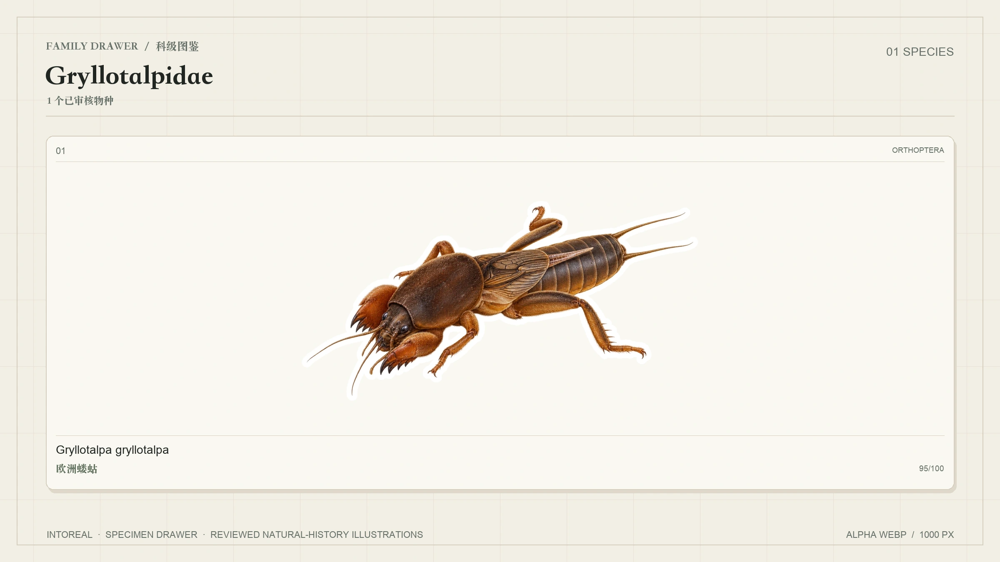
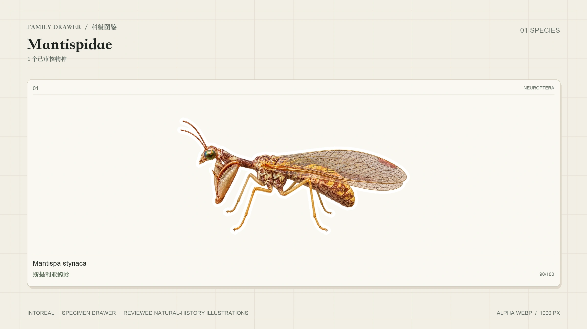
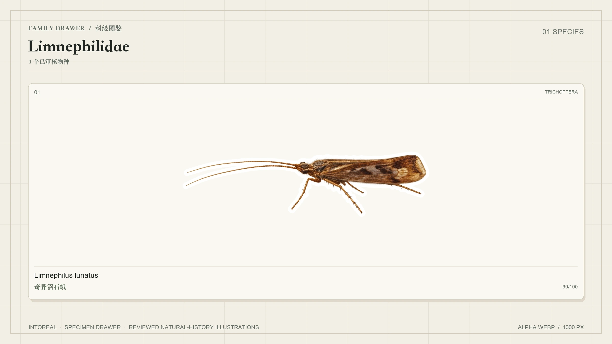
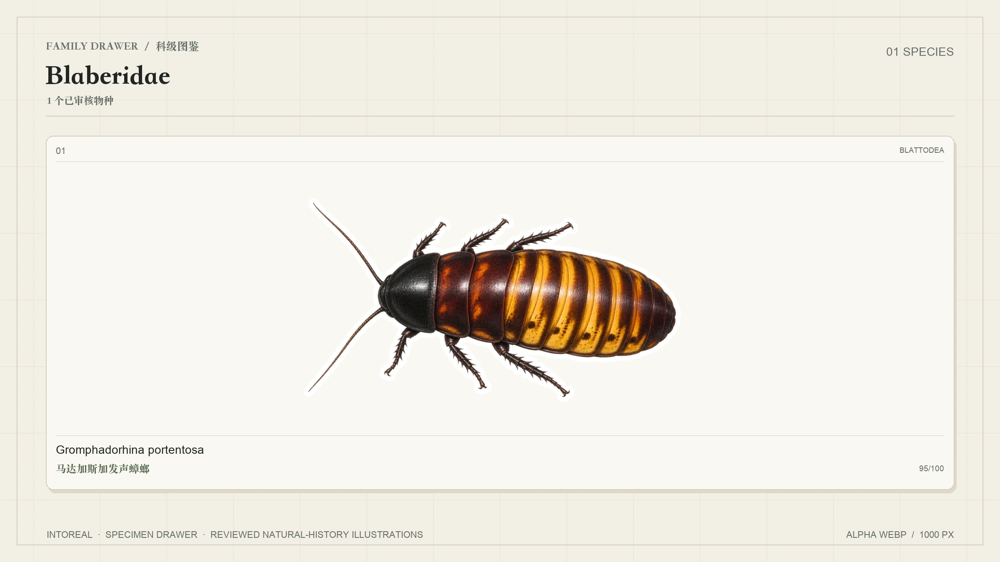
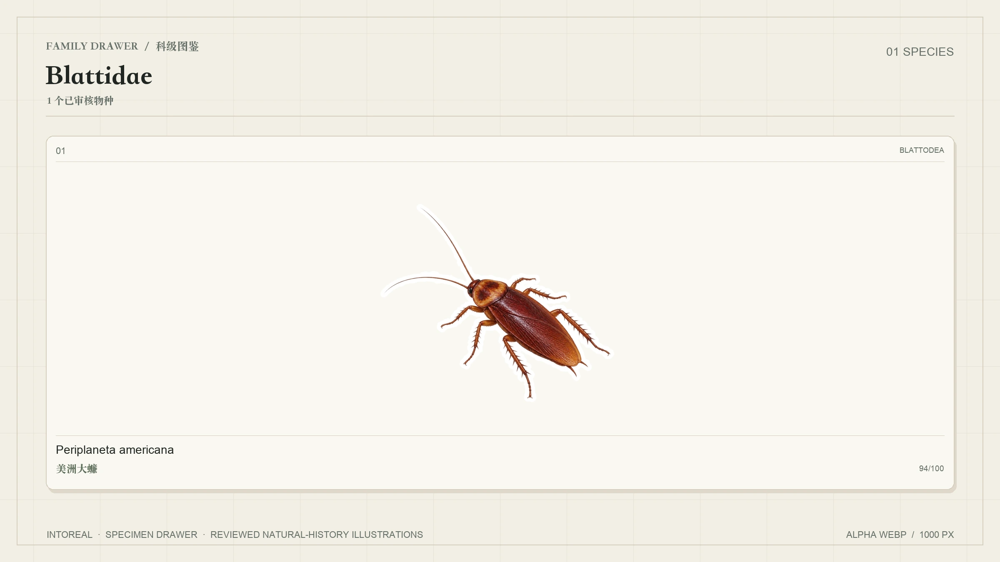

# IntoReal 昆虫贴纸图鉴


**IntoReal 开源的全球昆虫贴纸库：透明底白边 WebP 贴纸，附结构化分类、多语言名称、分布、审核分数和可追溯的参考来源。[English →](README.md)**

[English](README.md) · **简体中文**

当前公开图鉴包含 **11 个目、17 个科的 25 个已审核物种**。后续物种只有在通过同一套参考、生成、技术检查和独立审核流程后才会加入。当前数据使用 **46 个语言代码**，具体名称覆盖以 Wikidata 实际存在的标签为准。

**许可简述：** 贴纸和预览图可以用于任何用途，包括商用、复制、修改和再分发，**唯一的例外是提供与 IntoReal 竞争的昆虫识别或图鉴产品**。使用时注明 IntoReal-insect-sticker 并附仓库链接即可。项目整理的数据采用 MIT，第三方材料保留各自条款。详见 [LICENSE.md](LICENSE.md) 和 [NOTICE.md](NOTICE.md)。

## 特别致谢与推荐

本项目直接学习并受益于花叔的 [huashu-bird-sticker](https://github.com/alchaincyf/huashu-bird-sticker)。它清晰的仓库组织、贴纸与结构化元数据的结合方式、审核流程，以及对开放许可的认真设计，为我们开展昆虫图鉴项目提供了重要参照。

我们对此深表感谢，并**强烈推荐这个优秀的开源项目**。IntoReal-insect-sticker 是在其发布模式和数据组织基础上，面向昆虫世界独立扩展的实现；我们不复制其鸟类数据或插画，也不表示双方存在官方合作、隶属或背书关系。

## 图库

以下图版均由已通过审核的公开贴纸生成，未通过双审核的物种不会出现在图库中。

### 瓢虫科 · *Coccinellidae* — 4 种


### 蝼蛄科 · *Gryllotalpidae* — 1 种



### 螳蛉科 · *Mantispidae* — 1 种



### 沼石蛾科 · *Limnephilidae* — 1 种



### 折翅蠊科 · *Blaberidae* — 1 种



### 蜚蠊科 · *Blattidae* — 1 种



### 凤蝶科 · *Papilionidae* — 2 种


### 粉蝶科 · *Pieridae* — 1 种


### 蛱蝶科 · *Nymphalidae* — 2 种


### 天蚕蛾科 · *Saturniidae* — 1 种


### 蜓科 · *Aeshnidae* — 2 种


### 蟌科 · *Coenagrionidae* — 1 种


### 步甲科 · *Carabidae* — 1 种


### 蜜蜂科 · *Apidae* — 2 种


### 螳螂科 · *Mantidae* — 2 种


### 蝽科 · *Pentatomidae* — 2 种


### 食蚜蝇科 · *Syrphidae* — 1 种


### 已发布目级图版


## 仓库结构

| 路径 | 内容 |
|---|---|
| `stickers/<目>/<科>/<种>.webp` | 审核通过的透明底白边贴纸，长边约 1000px |
| `data/species.json` | 每个已发布物种的分类、名称、ID、分布、形态、保护状态、贴纸和来源 |
| `data/species.csv` | 核心数据的表格展开版本 |
| `data/names.csv` | 46 个语言代码的名称，包括地区变体 |
| `data/languages.json` | 语言代码及来源 |
| `data/field-guide.zh-Hans.json` | 25 个物种的中文形态、辨识和相似种说明，CC BY-SA 4.0 |
| `data/candidates-20.json` | 首批正式候选，其中 3 个 blocked 项不进入公开贴纸库 |
| `data/candidates-next.json` | 已完成生产的 3 个扩充物种 |
| `data/candidates-expansion-30.json` | 6 目、6 个洲际采样区域的 30 种证据矩阵，3 个试点中 2 种已发布、1 种保持 blocked；expansion-02 另有 3 种已发布，其余候选尚未获准生图 |
| `previews/` | 首页、目级和科级标本图版 |
| `scripts/` | Codex CLI 流水线、Issue worker、v2 任务包生成、元数据补充和预览渲染脚本 |
| `tests/` | 任务校验、独立审核、技术重试、修订替换和 Issue 收尾的回归测试；运行 `python3 -m unittest discover -s tests -v` |

字段定义与发布规则见 [data/README.md](data/README.md)。

单条记录示例（为便于阅读省略部分字段）：

```json
{
  "id": "Graphosoma_italicum",
  "scientificName": "Graphosoma italicum",
  "authority": "(O.F.Müller, 2066)",
  "taxonomy": {
    "system": "GBIF Backbone Taxonomy",
    "order": "Hemiptera",
    "family": "Pentatomidae",
    "genus": "Graphosoma"
  },
  "names": {
    "en": "Italian striped bug",
    "zh-Hans": "意大利条蝽"
  },
  "ids": {
    "wikidata": "Q56085742",
    "gbif": 7437802
  },
  "range": {
    "distribution": "欧洲"
  },
  "sticker": {
    "file": "stickers/Hemiptera/Pentatomidae/Graphosoma_italicum.webp",
    "kind": "ai-illustration",
    "reviewScore": 90,
    "primaryReviewScore": 85,
    "meetsQualityBar": true,
    "license": "PolyForm-Shield-1.0.0",
    "reference": {
      "type": "photo",
      "page": "https://commons.wikimedia.org/wiki/File:2013-06-07_21-00-56-Graphosoma-italicum.JPG",
      "author": "Thomas Bresson",
      "license": "CC-BY-3.0"
    }
  }
}
```

## 覆盖情况

- **公开贴纸：** 11 个目、17 个科的 25 个物种。
- **名称：** 46 个语言代码，使用 Wikidata 实际标签；缺失标签保持为空，不做机器翻译补全。
- **标识：** 25 个物种均具有精确匹配的 GBIF 和 Wikidata ID，以及 GBIF 命名权威。
- **保护状态：** 目前 6 个物种具有来自 Wikidata 的 IUCN LC 记录；没有声明的保护字段保持为空。
- **形态数据：** 目前 3 个物种具有 Wikidata 翅展记录；其他没有证据的形态字段不作推断。
- **中文图鉴：** 25 个物种的形态、辨识和相似种说明。
- **Blocked 候选：** 黄蜻、丝光绿蝇、金环胡蜂和沙漠蝗因未达到质量标准，未进入公开贴纸数据集。

首批候选不代表全球或地区完整性。后续物种也必须经过相同的生产和审核流程。

## 贴纸如何制作与审核

每个获批物种先准备多张参考照片或科研图版局部，并记录视角、生活阶段、作者、许可、本地路径和 SHA-256。Codex CLI 随后生成新的自然史插画，而不是复制照片。

生产流程包含两个相互独立的审核阶段：

1. **技术与一审：** 检查图片解码、RGBA 透明通道、画布边缘、哈希、解剖结构、辨识特征和展示质量。
2. **隔离盲审：** 全新的 Codex CLI 进程只接收获批参考、候选图、检查清单和候选哈希，不能读取生成记录、一审分数或先前评论。

新任务和修订任务还增加关键的结构与视角一致性检查：整体姿态必须得到全部指定参考的支持，不能因轮廓相似而忽略头部与身体的视角冲突。修订替换只有在双审通过、且声明的原图哈希仍与公开记录一致时才允许执行。

关键辨识特征失败会阻止发布，总分低于 80 也不通过；关键项失败时总分封顶 77。非关键视觉问题按检查清单扣分，不会被静默忽略。失败 attempt 和定向重画记录全部保留。达到重画上限的候选标记为 `blocked`，不导出公开贴纸。

GitHub Issue 用作任务队列和审计记录。单 worker 自动发现已准备的 Production Issue，串行执行、导出通过的 WebP 并关闭 Issue。网络错误会按流程重试，不重复 attempt，也不覆盖历史文件。

这些图片属于 AI 辅助自然史插画，不等同于专家分类鉴定。参考无法证明的特征会明确标记为 `unverifiable`。

## 参考照片

**原始参考照片和本地裁剪不进入公开仓库。** 每条公开记录都在 `sticker.reference` 和 `sticker.references` 中保存来源页面、作者和许可。

这些贴纸是新的插画。记录参考许可是为了便于筛选和核对，但并不把参考照片的许可直接等同于新插画的许可。原图权利仍归原作者所有。

如果你是参考图作者，不希望本项目使用相关材料，请[提交 Issue](https://github.com/hunknownz/intoreal-insect-sticker/issues)。我们会在 7 天内复核并替换或撤下相关内容。

## 使用数据

原始文件可直接访问：

```text
https://raw.githubusercontent.com/hunknownz/intoreal-insect-sticker/main/stickers/Hemiptera/Pentatomidae/Graphosoma_italicum.webp
```

```python
import json
species = json.load(open("data/species.json"))["species"]
by_name = {row["scientificName"]: row for row in species}
print(by_name["Graphosoma italicum"]["sticker"]["file"])
```

如果只需要数据和部分科级贴纸：

```bash
git clone --filter=blob:none --sparse https://github.com/hunknownz/intoreal-insect-sticker
cd intoreal-insect-sticker && git sparse-checkout set data stickers/Coleoptera stickers/Hemiptera
```

仓库包含可复现的流水线脚本，但本地参考照片按政策排除。

## 致谢

- **分类与 ID：** GBIF Backbone Taxonomy 和 GBIF species API，使用精确匹配的接受种。
- **名称与其他声明：** Wikidata 标签、学名、保护状态和形态声明（CC0）。
- **参考图片：** `data/species.json` 中逐种列出的摄影师和机构，主要来自 Wikimedia Commons。
- **生成与审核：** Codex CLI 图像生成、独立一审和隔离盲审。
- **仓库结构：** 参考 [huashu-bird-sticker](https://github.com/alchaincyf/huashu-bird-sticker) 的组织方式，改为全球昆虫集合，不复制其物种数据或插画。

完整的第三方来源和许可政策见 [NOTICE.md](NOTICE.md)。贴纸和预览图按 [PolyForm Shield 1.0.0](LICENSES/PolyForm-Shield-1.0.0.md) 授权，项目整理的数据按 [MIT](LICENSES/MIT.txt) 授权。
