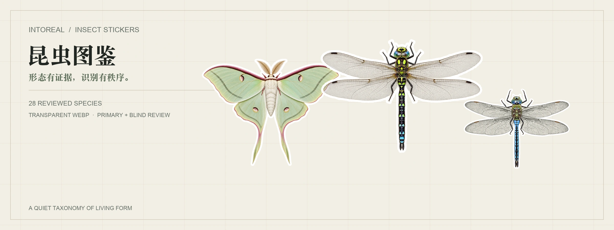
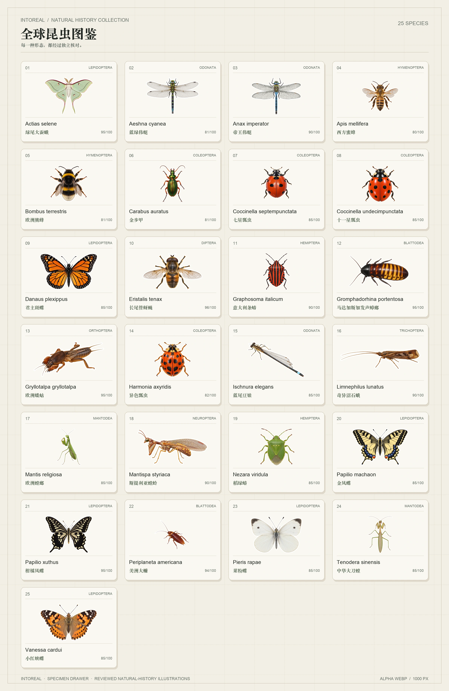

# intoREAL 昆虫贴纸图鉴



**面向全球昆虫、经过独立审核的白边贴纸库。[English →](README.md)**

每个正式发布的物种都包含透明底白边 WebP 贴纸、结构化分类与名称、分布简述、审核分数和可追溯的参考元数据。首批正式候选为 7 个目的 20 个物种；候选只有完成生产并通过全部审核后才会进入公开目录。



## 仓库结构

| 路径 | 内容 |
|---|---|
| `stickers/<目>/<科>/<种>.webp` | 审核通过的透明底白边贴纸，长边约 1000px |
| `data/species.json` | 分类、名称、分布、贴纸路径、审核分数和参考元数据 |
| `data/species.csv` | 核心数据的表格版本 |
| `data/names.csv` | 学名及当前可用俗名 |
| `data/languages.json` | 当前语言字段与来源 |
| `data/field-guide.zh-Hans.json` | 17 个已发布物种的中文形态、辨识与相似种说明 |
| `data/candidates-20.json` | 首批正式候选，不代表已发布数量 |
| `previews/` | 首页、目级和科级标本图版 |

字段定义与发布规则见 [data/README.md](data/README.md)。

## 制作与审核

参考照片仅在本地收集，记录作者和许可。Codex CLI 生成新的自然史插画，随后执行图片与哈希技术检查、独立一审，以及全新进程中的隔离盲审。关键辨识特征失败或总分低于 80 均不能发布，失败和定向重画记录全部保留。

GitHub Issue 用作任务队列和审计记录。单 worker 自动发现已准备的 Production Issue，串行执行、导出通过审核的贴纸并关闭 Issue。技术失败或盲审隔离破坏会保留 blocked 记录，不伪报成功。

这些图片属于 AI 辅助自然史插画，不能替代专家分类鉴定。参考无法证明的特征明确标记为 `unverifiable`。

## 参考照片

原始参考照片及本地裁剪**不进入公开仓库**。每条公开记录都在 `sticker.reference` 和 `sticker.references` 中保存来源页面、作者和许可。

## 使用数据

```python
import json
species = json.load(open("data/species.json"))["species"]
by_name = {row["scientificName"]: row for row in species}
print(by_name["Graphosoma italicum"]["sticker"]["file"])
```

原始贴纸链接形式：

```text
https://raw.githubusercontent.com/hunknownz/intoreal-insect-sticker/main/stickers/Hemiptera/Pentatomidae/Graphosoma_italicum.webp
```

## 当前状态

项目处于正式生产初期。更多物种、语言、鉴定说明和预览图版只会在有可靠资料时加入。尚未接入可靠来源的分类权威、跨数据库 ID 和保护状态字段保持为空。

贴纸与预览图按 [PolyForm Shield 1.0.0](LICENSES/PolyForm-Shield-1.0.0.md) 授权，项目整理的数据按 [MIT](LICENSES/MIT.txt) 授权。第三方材料保留各自条款，来源与参考照片政策见 [LICENSE.md](LICENSE.md) 和 [NOTICE.md](NOTICE.md)。
